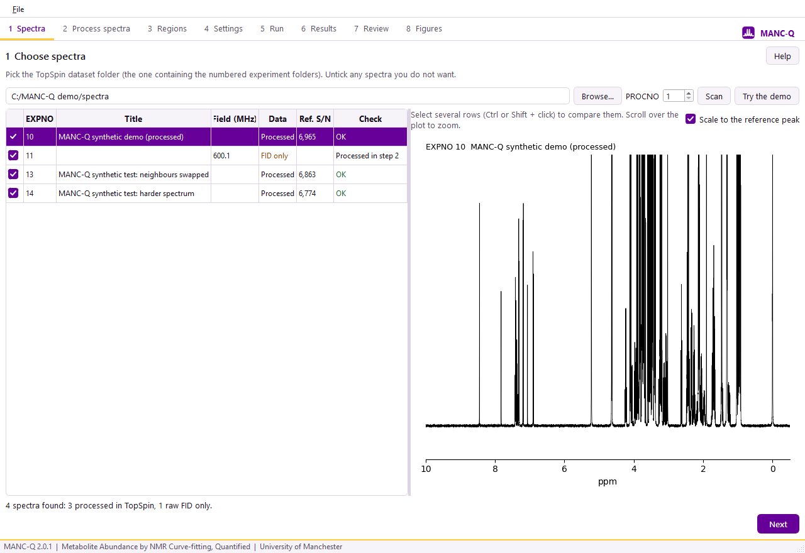
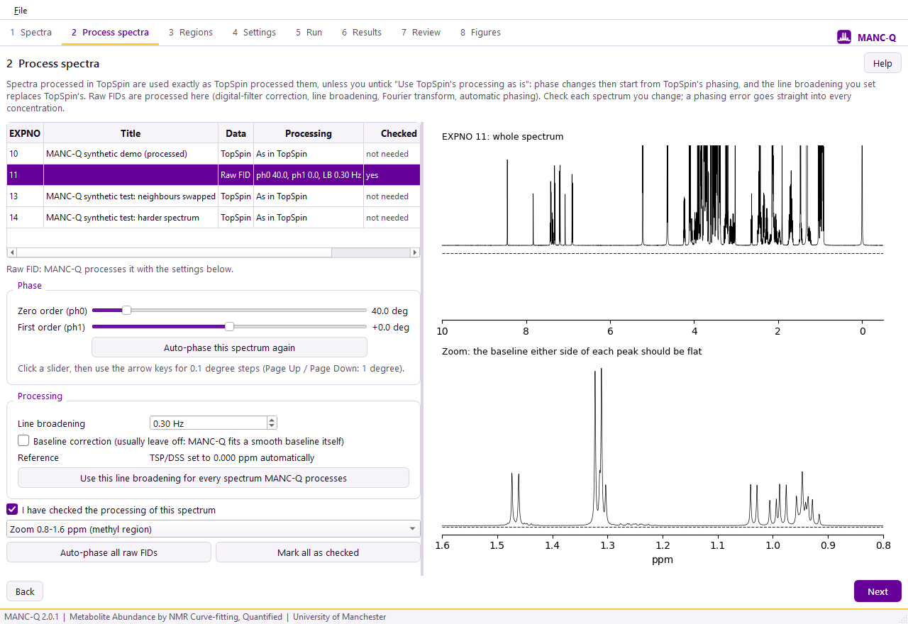
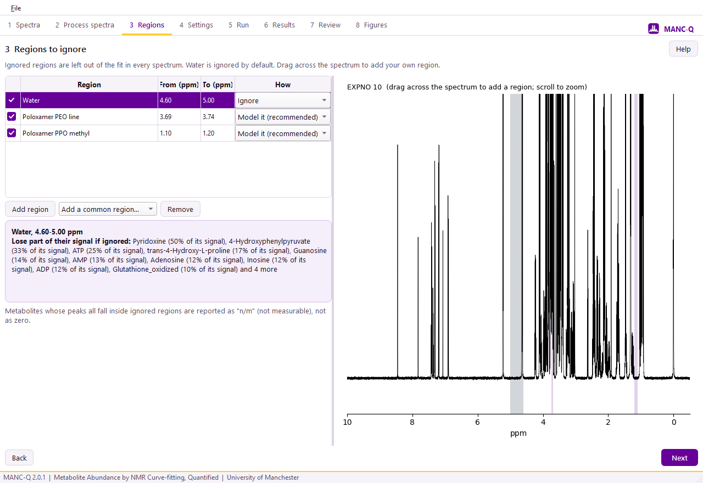
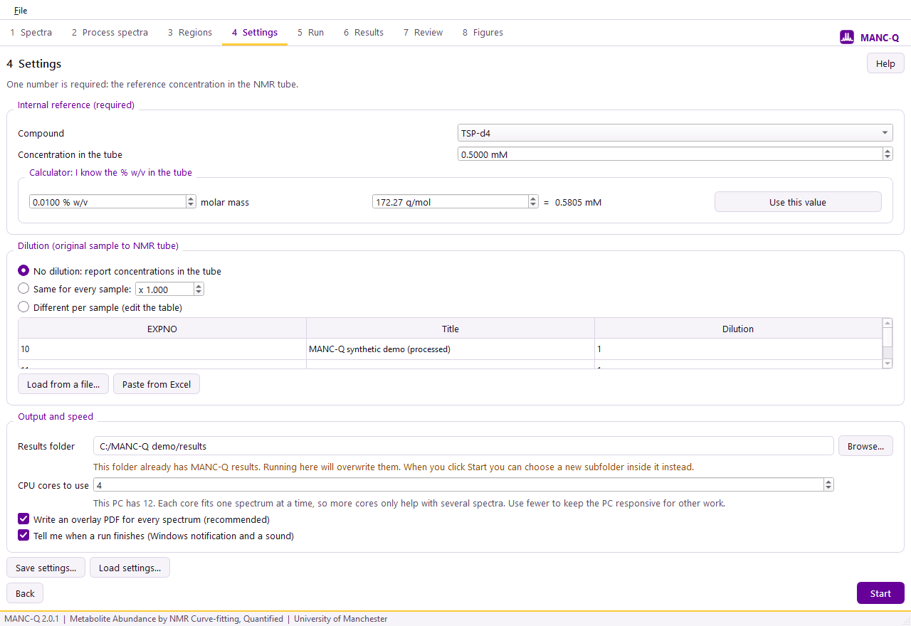
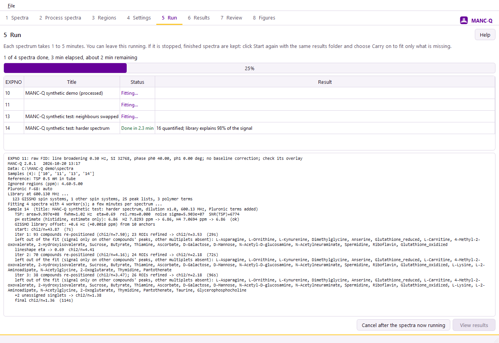
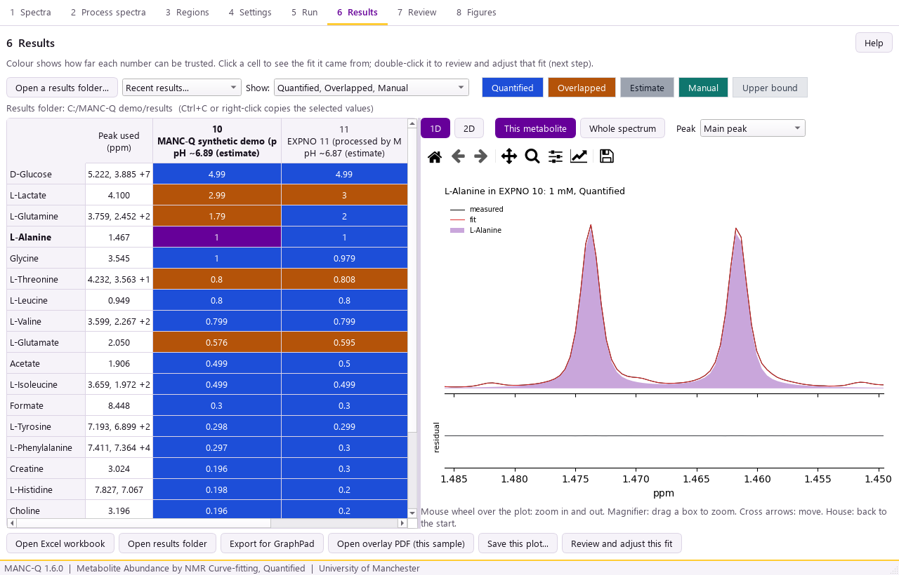
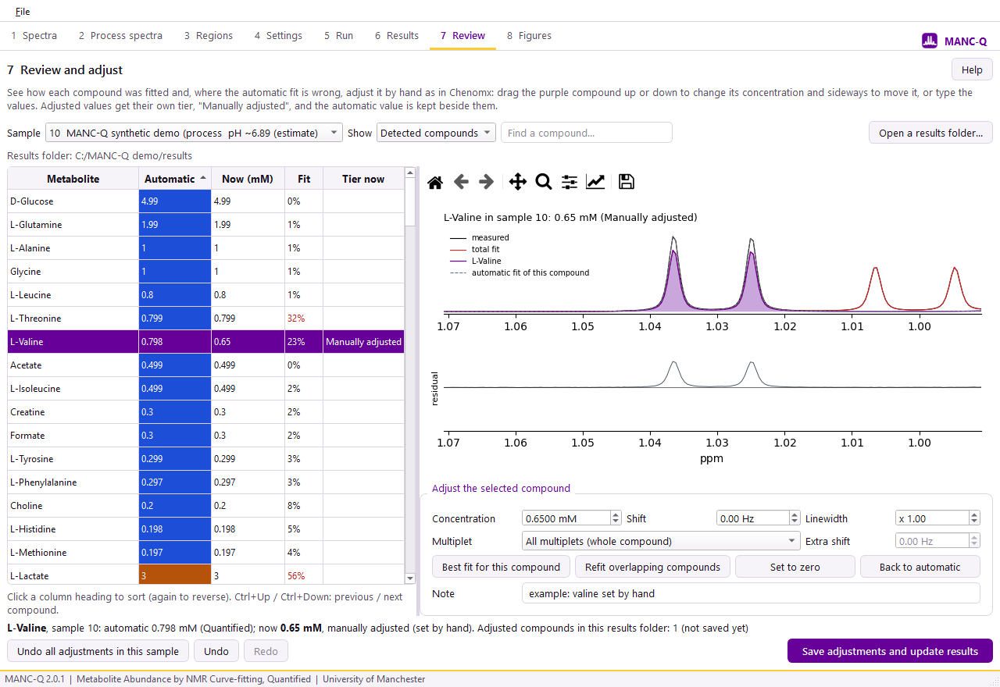
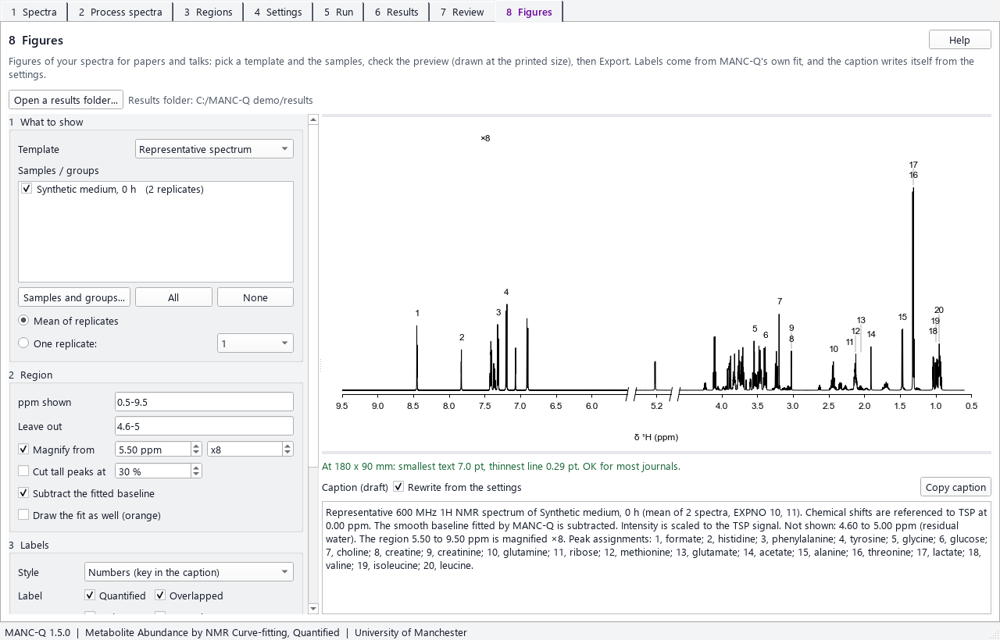

# MANC-Q quick start (graphical interface)

You need: a folder of Bruker 1D ¹H experiments (processed in TopSpin, or raw FIDs), and the TSP (or DSS)
concentration in the NMR tube. A run takes 1 to 5 minutes per spectrum.

**Start MANC-Q** from the Start menu (if you used the installer), or double-click MANC-Q.bat in the MANC-Q folder (or its desktop shortcut).

Every step has a **Help** button (top right) that shows its part of this guide. MANC-Q remembers your last
dataset folder, reference concentration, dilution, regions and other settings for next time; check them before
each run. (They are kept in `window_settings.json` in your AppData\MANC-Q folder; delete it to start afresh.)

The **File** menu (top left) opens a results folder, the help and About, and has **Dark mode**: tick it
for a black window instead of the usual white one (the spectra plots stay white, like paper). MANC-Q
remembers your choice.

## 1 Spectra

Click **Browse...** and choose the TopSpin dataset folder (the one that contains the numbered experiment
folders). Every experiment is listed. Untick any you do not want. The **Check** column flags spectra with a
weak or broad reference peak; click a row to see the spectrum. To compare spectra, select several rows (hold
Ctrl or Shift and click): they are drawn on top of each other, each divided by its reference peak (untick
**Scale to the reference peak** to see the raw intensities). Scroll over the plot to zoom.

First time? **Try the demo** makes two synthetic spectra (one processed, one raw FID) with known concentrations to practise on.

## 2 Process spectra

Every spectrum is listed. **Spectra processed in TopSpin** are used exactly as TopSpin processed them, as long
as **Use TopSpin's processing as is** stays ticked (the usual choice). To change one, untick it: the phase
sliders then show the *change* from TopSpin's phase (0 = TopSpin's), and the line broadening you set replaces
TopSpin's (TopSpin's value is shown next to it). The grey trace is TopSpin's spectrum, for comparison.
MANC-Q needs TopSpin's imaginary part (`1i`) or the raw FID to do this; if both are missing the spectrum can
only be used as it is.

**Raw FIDs** are processed and phased automatically. For each one, look at the zoomed view: the baseline either
side of the peaks should be flat, with no dips below the dashed line. If it is not, move the **ph0** slider
until it is.

To fine-tune the phase, click a slider and use the arrow keys (0.1 degree steps; Page Up / Page Down for 1
degree). **Auto-phase all raw FIDs** phases every FID automatically in one go.

Tick **I have checked the processing** for every spectrum MANC-Q processes (**Mark all as checked** does it for
all of them, once you have looked at each). Phasing errors change
concentrations, so do not skip this. **Baseline correction** is off by default: MANC-Q fits a smooth baseline
itself, and an extra correction can distort broad signals. The settings used are saved in the results folder
(`processing_used.csv`), so a run can be repeated exactly, also from the command line.

## 3 Regions

Regions left out of the fit. Water is ignored by default. If your medium contains poloxamer (Pluronic F-68),
leave it on **Model it**. To ignore anything else, drag across the spectrum or use **Add a common region**.
The purple box tells you which metabolites lose signal in the selected region.

## 4 Settings

Enter the **reference concentration in the tube** (the calculator converts % w/v), the **dilution** from your
original sample to the tube (or "No dilution" for tube concentrations), and check the results folder.
For different dilutions per sample, type them in the table, or click **Load from a file...** (a CSV or Excel
file with the EXPNO in the first column and the dilution in the second) or copy the two columns in Excel and
click **Paste from Excel**. MANC-Q tells you which spectra got no dilution and which rows matched no spectrum.
**CPU cores to use** sets how many spectra are fitted at the same time (one per core; the default is all but
one). Fewer cores leave the PC free for other work; more cores only help when there are several spectra. With
**Tell me when a run finishes** ticked, Windows shows a notification and plays a sound at the end of a run.
Click **Start**.

If the results folder already holds MANC-Q results, a warning appears under it: "This folder already has
MANC-Q results. Running here will overwrite them." When you click **Start** you choose:

* **New subfolder** (the default): the run goes into a new folder such as `run_2026-10-19_1340` inside it, and
  the old results stay as they are.
* **Overwrite**: the old results are deleted, including manual adjustments made in the Review step and the
  spectra MANC-Q processed, then the run starts. Your own files, the Figures settings and the sample sheet are kept.
* **Cancel**: nothing happens, so you can choose another folder.
* **Carry on the stopped run** (only if the run in that folder was stopped or crashed, with the same spectra):
  spectra it finished are kept, if nothing that affects their values has changed, and only the rest are fitted.

## 5 Run

Progress for each spectrum and the time remaining (also shown in the window title, so you can see it while
working in another program). You can cancel; finished spectra are kept, and **Start** with the same results
folder then offers **Carry on the stopped run**.

## 6 Results

Each value is coloured by how far it can be trusted:

| Colour | Meaning | Use |
|---|---|---|
| Blue | Quantified | a measurement |
| Orange | Overlapped | semi-quantitative; good for trends |
| Grey (`~`) | Deconvolution estimate | an estimate only |
| Teal | Manually adjusted | set by hand in step 7; the automatic value is kept alongside |
| Pale grey (`<=`) | Upper bound | the most it can be; not a measurement |
| `<LOD` / `n/m` | not detected / not measurable (region ignored) | |

**Not detected is recorded as 0 mM.** Metabolites graded Not detected are recorded as 0 mM. A zero means the
signal was below this sample's detection limit (LOD_mM). It may reflect true absence, a concentration too low to
detect, or a peak MANC-Q could not resolve in that spectrum. It is not proof that the metabolite is absent.
Upper bounds are not measurements, so they are blank in the workbook's Concentration_mM_all sheet and in
`concentrations_long.csv` (the bound is in Report_mM as `<=value` and in the `upper_bound_mM` column), and they
are never included in the means on the Summary sheet.

**Quality of each spectrum.** Above each column, `QC: check` (amber) or `QC: poor` (red) marks a spectrum
worth a look; hover over the column title for the reasons: a broad TSP line (shimming), a TSP line much
broader than the metabolites (TSP bound to protein, which makes every value too high), a poor fit, little of
the signal explained, many unassigned singlets, a residual phase error (re-phase it in step 2), a short
relaxation delay (D1 + AQ under 10 s), or a histidine pH warning. The same is in the qc_flag and qc_reason
columns of the QC sheet, with the acquisition parameters (D1, AQ, NS, RG, pulse programme, temperature, P1).

Click any value to see the fit it came from; double-click it (or click **Review and adjust this fit**) to
open it in step 7. **Open Excel workbook** gives every table; **Export for GraphPad** writes samples x
metabolites with only the values you chose to show.

* **Copy:** select cells and press **Ctrl+C** to copy them as shown, with metabolite and sample names, ready to
  paste into Excel. Right-click and choose **Copy numbers only** to get plain numbers (blank where there is no
  reportable value), for Prism or calculations.
* **The plot on the right** has two pairs of buttons. **This metabolite** zooms to the selected metabolite and
  **Whole spectrum** shows the whole spectrum, with the metabolite filled in purple and arrows over its peaks.
  **Peak** picks which of its peaks to zoom to (the main one, all of them, or any single one). Turn the mouse
  wheel over the plot to zoom in and out; the toolbar above it has a magnifier (drag a box to zoom), cross
  arrows (move around) and a house (back to the start).
* **2D spectra (TOCSY, COSY):** click **2D** to see the 2D spectrum of the same sample. MANC-Q finds it by
  itself: a processed 2D experiment (`pdata/1/2rr`) in the same data folder with the same title, nearest in
  EXPNO. If the nearest 2D has a different title, it is still shown but with a red warning, because it may be a
  different sample; **Choose 2D spectrum...** picks the right EXPNO folder by hand (remembered in the results
  folder). The 2D is moved so that its TSP peak is at 0 ppm, like the 1D. Circles mark the cross peaks the
  metabolite should give (protons coupled to each other in its library spin system, at the positions fitted in
  the 1D): **green = seen** (a real peak top there, at least 10 x the 2D noise), **red = missing**. The 1D with
  the metabolite in purple is drawn above the 2D. **Contours from** sets the lowest contour level (raise it if
  the plot is crowded). **2D check of all metabolites...** lists every metabolite of the sample with how many of
  its expected cross peaks are seen, and can save that as `twod_check_sample_<EXPNO>.csv`. The 2D is a check of
  identity only: it never changes a value. Seen cross peaks support an assignment; missing ones on a strong
  metabolite deserve a look; weak metabolites may simply be too weak for the 2D. Compounds from fixed peak
  lists and singlets (for example formate, acetate) have no cross peaks to check.
* **Estimated pH:** under each sample name the table shows `pH ~7.05 (estimate)`: the pH in the NMR tube when
  the spectrum was recorded (not in the culture), worked out from where the two histidine ring peaks sit (H2 near
  7.8 ppm, H4 near 7.05 ppm; they move with pH). Hover over the sample name to see how it was found. It is an
  estimate: changes between samples are reliable, but the absolute value is only good to about plus or minus
  0.2 units, because the constants used (from free histidine in water) were not measured in your medium. It needs
  histidine peaks at least 10 x the noise; otherwise it shows `pH n/a`. The values and the two separate readings
  (`pH_H2`, `pH_H4`, with a `pH_flag`) are in `qc_per_sample.csv` and the QC sheet of the workbook. MANC-Q also
  uses these peak positions to hold histidine in place in the fit, so it cannot slide onto a neighbouring peak
  (for example tryptophan at 7.74 ppm).
* **Peak used (ppm):** the first column says where each metabolite is measured: the fitted centre of the
  peak(s) MANC-Q used for its value (its reporter peaks), as the median over the samples where it was
  Quantified or Overlapped. Hover over a value to see the peak(s) used in that sample. The same information
  is in the `reporter_ppm` column of `concentrations_long.csv` and the `Long_table` sheet. Results made
  before version 1.5 take it from the peak list.
* **Chemical shift table for your paper:** every run also writes `chemical_shift_assignments.xlsx` in the
  results folder (and the `Shift_assignments` sheet of the workbook): one row per metabolite with its 1H
  chemical shifts (the fitted peak centres, median over the samples), `*` on the peaks used to quantify it
  and `**` on peaks used but shared with another metabolite, the number of samples, and the reference
  spectrum (for example GISSMO bmse000208), with a footnote explaining it all, ready for a supplementary
  table. It lists metabolites that were Quantified, Overlapped or Manually adjusted in at least 25 % of the
  samples (settings `SHIFT_TABLE_TIERS` and `SHIFT_TABLE_MIN_FRACTION`); it is rewritten whenever the
  results are (after Review adjustments, or `mancq regrade`).
* **Save this plot...** saves the plot on the right as PNG (300 dpi), SVG (editable) or PDF.
* **Recent results...** reopens results folders you looked at before.

## 7 Review and adjust (optional)

This works like Chenomx. Pick a **sample**, then a compound in the list (**Show** chooses detected, all, or
adjusted compounds; type in the box to find one). The plot shows the measured spectrum (black), the total fit
(red), the selected compound (purple), its neighbours (thin coloured lines) and, below, what is left over
(the residual). Scroll over the plot to zoom; the toolbar above it can pan and zoom too.

The **Fit** column says how far the measured spectrum differs from the fit around each compound's peaks, as a
share of the compound's own signal (lower is better; above 25 % is shown in red). Click any column heading to
sort by it, as in File Explorer, and click again to reverse: sorting **Fit** with the worst first is the
quickest way to find the compounds worth checking. **Ctrl+Down** and **Ctrl+Up** move to the next and previous
compound in the list.

To adjust the selected compound:

* **Drag it** with the mouse: up or down changes the concentration, sideways moves it. Or type the
  **Concentration**, **Shift** (Hz) and **Linewidth** (a factor; 1 = as fitted).
* Choose one **Multiplet** to zoom to it and give it an **Extra shift** of its own (useful for pH-sensitive
  compounds).
* **Best fit for this compound** finds the concentration, shift and linewidth that best match the data around
  its peaks, keeping everything else as it is.
* **Refit overlapping compounds** keeps this compound as it is and refits the compounds under its peaks. You
  see the changes before they are applied; those compounds are marked as adjusted too.
* **Set to zero** if the compound is not in the sample; **Back to automatic** removes the adjustment.
* Write a **Note** saying why. It is saved with the result, with your user name and the time.
* **Undo** (Ctrl+Z) and **Redo** (Ctrl+Y) step back and forward through your adjustments; a drag or a run of
  typing on one compound counts as one step.

The dashed grey line shows the automatic fit of the compound, so you can see what you changed. Nothing is
changed until you click **Save adjustments and update results**: the workbook, tables, overlay PDFs and step 6
are then rewritten (in seconds, nothing is refitted). Adjusted values have the tier **Manually adjusted**; the
automatic tier and value stay in the `Long_table` sheet (columns `auto_tier`, `auto_conc_mM`), and every change
is listed in the `Manual_edits` sheet. If a spectrum is fitted again later, its adjustments are set aside
because they refer to the earlier fit.

## 8 Figures

Figures of your spectra for papers, posters and talks, from the results open in step 6 (or **Open a results
folder...**). Everything is drawn from the spectra MANC-Q fitted: each spectrum is divided by its own TSP
signal, so all spectra share one vertical scale, and by default the smooth baseline MANC-Q fitted is
subtracted (untick **Subtract the fitted baseline** to show the spectrum as measured).

**1 What to show.** Pick a **Template**:

| Template | What it shows |
|---|---|
| Representative spectrum | one spectrum with numbered or abbreviated peak labels, water region cut out, the weak aromatic region magnified |
| Fit evidence | the measured spectrum with the total fit, each metabolite you tick on its own row (same scale) and the residual: the figure reviewers ask for when two metabolites overlap (for example lactate and threonine) |
| Time course (stacked) | several spectra stacked with a small vertical offset, on one scale, labelled on the right |
| Overlay with inset | several spectra overlaid in colour, with an enlarged inset; a dashed box marks where the inset comes from |

Tick the samples to draw. **Samples and groups...** says which samples belong together: type the **group**
(condition, reactor, medium...), the **time** and the **replicate** for each EXPNO, paste them from Excel, or
**Load sample sheet** (CSV or Excel). A sample sheet needs one row per sample; columns can be called `sample` or
`EXPNO`, `group` or `condition`, `time_h`, `time`, `hours` or `day`, `replicate` or `rep`, and `label`. Times
can be written 12, 12 h, 0.5 hr, 2 d or day 3. Any other columns (feed, VCD, viability...) are kept. Mistakes
do not stop it: a sample listed twice, a sample that is not in the results or a time it cannot read is
reported, and the rest is used. **Save a sheet to fill in** writes a CSV with your samples and their NMR titles
to complete in Excel. The groups are saved in the results folder (`sample_sheet.csv`).

Replicates of one group at one time become one line: either the **Mean of replicates**, or **One replicate**
(choose which; the caption names it).

**Colours:** click a spectrum in the list and **Colour...** (or double-click it) to choose its colour; the
small square next to each spectrum shows its colour, and the caption names it (red, blue...). **Fit
colour...** sets the colour of the fitted spectrum (Manchester purple unless you change it), in the fit
evidence template and when **Draw the fit as well** is ticked. **Reset colours** goes back to black (or to
colour-blind safe colours in an overlay) and the purple fit.

**2 Region.** The ppm range shown (several pieces are allowed, for example `0.8-1.6, 3.0-4.2`), the regions to
**Leave out** (drawn as breaks in the axis; the water region is filled in from your run), **Magnify** the
region above a ppm (marked x8 or similar), and **Cut tall peaks** above a share of the tallest one (each cut
peak is marked ~). For the time course and the overlay, **Offset upwards** raises each spectrum above the
one before (a share of the plot height; 0 = on top of each other) and **Offset sideways** moves each one to
the right by a number of ppm, for a staggered, angled stack. With a sideways offset the ppm scale belongs to
the first (bottom) spectrum, and the caption says so. Fit evidence has its own list of metabolites and its own ppm range (empty = around the main
peaks of the metabolites you ticked). The list has every metabolite: those with a value first, then (in grey)
those that are only an upper bound or not detected, so you can still show, for example, why glutamine is only an
upper bound. The figure marks them `<=` or `n.d.` and the caption says they have no value.

**3 Labels.** Labels come from MANC-Q's own fit: the metabolites graded as you tick (Quantified by default),
at their fitted peak positions: by default one label per metabolite, at its main peak. Tick **Upper bound** or
**Not detected** to label those metabolites too; the caption then says they are labelled for reference only,
with no value from MANC-Q. **Show all** and **Hide all** show or hide every label at once (handy for hiding them
all and then ticking back the few you want in **Edit labels...**). **Numbers** puts
numbers on the plot and the key in the caption; **Abbreviations** writes Lac, Ala, Glc and so on. Crowded
labels are moved up and joined to their peak by a thin line, and wide multiplets get a bracket. **Edit
labels...** lets you hide a label, change its text, add a symbol (`*` contaminant or poloxamer, `~` peak cut
off, `#` 13C satellite; each is explained in the caption), or add your own label at any ppm.

**4 Size and export.** Choose the printed width (single column 85 mm, 1.5 column 120 mm, double column 180 mm,
or Custom: check your journal), the height, the text size and the line width. The preview is drawn at that
printed size, and the line under it checks the smallest text and thinnest line (most journals want at least
6 pt text and 0.25 pt lines). Type a **Figure name** (for example `Fig2_lactate_fit`) to save the figure under
that name; an earlier figure is never overwritten without asking (if the name is taken, _2, _3 ... is added).
**Export...** saves PDF, SVG (editable in Illustrator or Inkscape), EPS, TIFF
(1200 dpi) and PNG (600 dpi), and can also save the caption, the data behind the figure (CSV), a processing
record (which spectra, how they were processed, every setting) and a small Python script that draws the figure
again.

The **Caption** below the preview is a draft that rewrites itself from the settings: field strength, pulse
sequence, reference, what was cut out or magnified, the label key. Edit it freely (it then stops rewriting
itself until you tick **Rewrite from the settings** again) and **Copy caption** into your paper. Your figure
settings and label edits are kept in the results folder (`figures/figure_settings.json`).
